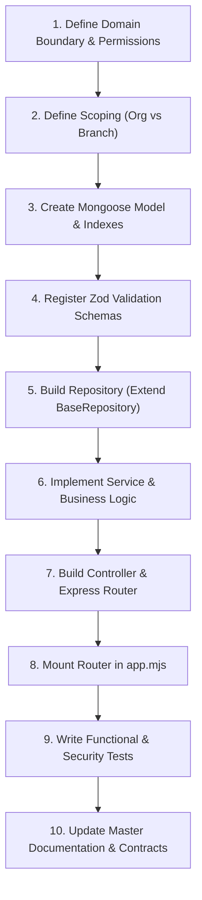

# Unisex Parlour ERP — Technical Documentation Set & Module Master Index

```text
Status: Canonical Living Master Index
Parent Architecture: ARCHITECTURE.md
Backend Standard: BACKEND_MODULE_ARCHITECTURE_STANDARD.md v1.0
Module Architecture Standard: MODULE_ARCHITECTURE_STANDARD.md v1.1
Last Updated: 2026-10-28
Audience: Technical Leads, Backend Engineers, Frontend Engineers, QA Engineers, AI Coding Agents
```

---

## 📑 Table of Contents

1. [Executive Summary & Source of Truth Hierarchy](#1-executive-summary--source-of-truth-hierarchy)
2. [Documentation Set Directory Reference](#2-documentation-set-directory-reference)
3. [Master Module Status Matrix](#3-master-module-status-matrix)
4. [Completed Backend Modules (Deep Dive)](#4-completed-backend-modules-deep-dive)
   - [4.1 Multi-Tenancy, Organizations & Branch Scoping](#41-multi-tenancy-organizations--branch-scoping)
   - [4.2 Authentication, Session Lifecycle & User Management](#42-authentication-session-lifecycle--user-management)
   - [4.3 Role-Based Access Control (RBAC) & Canonical Permissions](#43-role-based-access-control-rbac--canonical-permissions)
   - [4.4 Customers & Customer Relationship Management (CRM)](#44-customers--customer-relationship-management-crm)
   - [4.5 Services & Service Categories](#45-services--service-categories)
   - [4.6 Staff & Operational Employee Management](#46-staff--operational-employee-management)
   - [4.7 Staff Leaves & Time-Off Management](#47-staff-leaves--time-off-management)
   - [4.8 Appointments & Booking Engine](#48-appointments--booking-engine)
   - [4.9 Subscriptions & Membership Plans](#49-subscriptions--membership-plans)
   - [4.10 Billing & Point of Sale (POS)](#410-billing--point-of-sale-pos)
   - [4.11 Loyalty Program & Points Ledger](#411-loyalty-program--points-ledger)
   - [4.12 Immutable Audit Logs](#412-immutable-audit-logs)
   - [4.13 Media & Direct Uploads (Cloudinary)](#413-media--direct-uploads-cloudinary)
   - [4.14 Background Jobs & Asynchronous Queues (BullMQ)](#414-background-jobs--asynchronous-queues-bullmq)
5. [Pending & Planned Modules (Technical Specifications & Roadmap)](#5-pending--planned-modules-technical-specifications--roadmap)
   - [5.1 Attendance Tracking & Biometric Punch Management](#51-attendance-tracking--biometric-punch-management)
   - [5.2 Salary & Payroll Processing (with Commission Engine)](#52-salary--payroll-processing-with-commission-engine)
   - [5.3 Expenses & Petty Cash Management](#53-expenses--petty-cash-management)
   - [5.4 Finance, Day-End Reconciliation & GST Tax Accounting](#54-finance-day-end-reconciliation--gst-tax-accounting)
   - [5.5 Inventory, Product Retail & In-Service Consumables](#55-inventory-product-retail--in-service-consumables)
   - [5.6 Procurement & Supplier / Vendor Management](#56-procurement--supplier--vendor-management)
   - [5.7 Coupons, Promotional Discounts & Gift Vouchers](#57-coupons-promotional-discounts--gift-vouchers)
   - [5.8 WhatsApp Business API & Automated Client Messaging](#58-whatsapp-business-api--automated-client-messaging)
   - [5.9 Marketing Campaigns & Automated Customer Lifecycle Engine](#59-marketing-campaigns--automated-customer-lifecycle-engine)
   - [5.10 Executive Analytics Dashboard & BI Reporting Engine](#510-executive-analytics-dashboard--bi-reporting-engine)
   - [5.11 Settings, Store Hours, Sequence & Automated Backups](#511-settings-store-hours-sequence--automated-backups)
   - [5.12 Next.js Frontend Application Modules](#512-nextjs-frontend-application-modules)
6. [Architectural Invariants & Non-Negotiable Guardrails](#6-architectural-invariants--non-negotiable-guardrails)
7. [New Module Implementation Workflow & Checklist](#7-new-module-implementation-workflow--checklist)

---

## 1. Executive Summary & Source of Truth Hierarchy

This documentation set governs the architecture, data ownership, isolation boundaries, security policies, API contracts, and development standards for the **Unisex Parlour Enterprise Resource Planning (ERP)** system.

The ERP backend is implemented using **Node.js, Express 5, MongoDB (Mongoose 9 with Replica Set transactions), Redis (ioredis), and BullMQ**, strictly adhering to a layered architecture:
```text
HTTP Request
     ↓
Express Router
     ↓
Authentication Middleware (authenticate)
     ↓
Scope Enforcement Middleware (requireOrganizationScope / requireBranchScope / requireActiveBranch)
     ↓
Authorization Middleware (requirePermission / authorize)
     ↓
Request Validation (Zod schemas via validate)
     ↓
Controller Layer (extract inputs, delegate to service, format response)
     ↓
Service Layer (business logic, transactions, cross-model invariants, domain rules)
     ↓
Repository Layer (data access, tenant/branch query scoping, soft-delete exclusion)
     ↓
Database Models (Mongoose schemas, indexes, hooks, global auditPlugin)
```

### Source of Truth Hierarchy

When resolving conflicts across specifications, code, or documentation, the following strict hierarchy **MUST** be enforced:

1. **Security & Runtime Isolation Contracts**: Authoritative for endpoints, tenant isolation, and branch scoping rules.
2. **Approved Architectural Invariants** (`ARCHITECTURE.md`, `BACKEND_MODULE_ARCHITECTURE_STANDARD.md`).
3. **Canonical Permission Registry** (`src/config/permissions.js` and `PERMISSIONS.md`).
4. **Existing Core Shared Infrastructure** (`src/middleware/`, `src/database/plugins/audit.js`, `src/utils/`).
5. **Verified Reference Module Implementations** (Customer, Staff, Leaves, Appointments, Subscriptions, Billing).
6. **Implementation Proposals & Scratch Docs**.
7. **Developer / AI Agent Assumptions**.

> ⚠️ **Conflict Handling Rule**: If any documentation conflicts with the authoritative runtime security contract, developers and AI agents must **STOP and report** the discrepancy rather than guessing.

---

## 2. Documentation Set Directory Reference

All foundational architecture specifications reside in this directory (`docs/UNISEX_PARLOUR_ERP_TECHNICAL_DOCUMENTATION_SET/`):

| File Name | Scope & Authority | Summary Description |
|:---|:---|:---|
| **`README.md`** *(This file)* | Master Index & Module Status | Authoritative status matrix of all completed and pending modules, technical specifications, and implementation roadmap. |
| **`ARCHITECTURE.md`** | Parent Architecture Specification | High-level system architecture, multi-tenant isolation model, branch scoping principles, domain boundaries, and security rules. |
| **`BACKEND_ARCHITECTURE.md`** | Backend Engineering Standard | Layered backend structure, middleware pipeline sequencing, error handling envelope, and controller-service-repository patterns. |
| **`BACKEND_MODULE_ARCHITECTURE_STANDARD.md`** | Backend Module Canonical Standard | Mandatory standard (v1.0) governing model design, transaction rules, query scoping, optimistic concurrency, and audit trails. |
| **`MODULE_ARCHITECTURE_STANDARD.md`** | End-to-End System Standard | Full-stack standard (v1.1) bridging Next.js frontend requirements with Express backend contracts and React Query caching. |
| **`DATABASE_ARCHITECTURE.md`** | Data Layer Architecture | Database collection conventions, single-branch vs multi-branch schemas, relationship joins, indexing rules, and soft-delete invariants. |
| **`API_CONTRACT.md`** | API Conventions & Protocols | Standardized response envelopes (`success`, `status`, `data`, `meta`, `errors`), status codes, headers, and pagination query params. |
| **`AUTHENTICATION.md`** | Auth & Session Specification | Token lifecycle (Access JWT + Refresh Token), MongoDB session storage, refresh token rotation, breach detection, and OTP activation flows. |
| **`PERMISSIONS.md`** | Authorization & RBAC Specification | Canonical permission registry (~90+ keys), permission-based authorization rules, Redis role caching, and role assignment matrices. |
| **`FRONTEND_ARCHITECTURE.md`** | Next.js Frontend Standard | Next.js App Router conventions, feature folder structures, React Query hook conventions, and UI authorization guards. |
| **`TESTING_STRATEGY.md`** | Quality & Verification Standard | Functional testing requirements, tenant isolation verification, cross-branch security test matrices, and regression suites. |
| **`DEVELOPMENT_WORKFLOW.md`** | Domain Engineering Workflow | Step-by-step phased workflow (Phases 1 through 9) for taking any new domain from concept to verified production deployment. |
| **`STAFF_BACKEND_ARCHITECTURE_AND_IMPLEMENTATION_PLAN.md`** | Module Blueprint: Staff | Approved architecture plan for operational staff, code sequences, primary branch transitions, and user linkage. |
| **`STAFF_BACKEND_CONTRACT.md`** | Verified Staff API Contract | Complete API reference and field definitions for staff profiles, branch assignments, and service capabilities. |
| **`LEAVES_BACKEND_ARCHITECTURE_AND_IMPLEMENTATION_PLAN.md`** | Module Blueprint: Leaves | Approved architecture plan for staff leaves, calendar overlap prevention multikey index, and self-service approval workflows. |

---

## 3. Master Module Status Matrix

The following matrix provides an exhaustive snapshot of the current state of every module in the Unisex Parlour ERP:

| Module Name | Domain Scope | Backend Status | Tests Status | Frontend Status | Primary Module Document |
|:---|:---|:---:|:---:|:---:|:---|
| **Multi-Branch & Organizations** | Foundation / Multi-Tenancy | ✅ Completed | ✅ 100% Passed | 🏗 Partially Wired | [`BRANCHES_ORGANIZATIONS_README.md`](BRANCHES_ORGANIZATIONS_README.md) |
| **Authentication & Sessions** | Security / Identity | ✅ Completed | ✅ 100% Passed | 🏗 Partially Wired | [`AUTH_USERS_README.md`](AUTH_USERS_README.md) |
| **Users & Lifecycle** | Administration / Identity | ✅ Completed | ✅ 100% Passed | 🏗 Partially Wired | [`AUTH_USERS_README.md`](AUTH_USERS_README.md) |
| **RBAC & Permissions** | Authorization / Governance | ✅ Completed | ✅ 100% Passed | 🏗 Partially Wired | [`RBAC_PERMISSIONS_README.md`](RBAC_PERMISSIONS_README.md) |
| **Customers & CRM** | Core Operations / Profiles | ✅ Completed | ✅ 100% Passed | ⏳ Ready for UI | [`CUSTOMERS_README.md`](CUSTOMERS_README.md) |
| **Services & Categories** | Catalog / Pricing / Taxes | ✅ Completed | ✅ 100% Passed | ⏳ Ready for UI | [`SERVICES_README.md`](SERVICES_README.md) |
| **Staff & Personnel** | Human Resources / Operations | ✅ Completed | ✅ 100% Passed | ⏳ Ready for UI | [`STAFF_README.md`](STAFF_README.md) |
| **Leaves & Time-Off** | Human Resources / Scheduling | ✅ Completed | ✅ 100% Passed | ⏳ Ready for UI | [`LEAVES_README.md`](LEAVES_README.md) |
| **Appointments & Scheduling** | Core Engine / Booking | ✅ Completed | ✅ 100% Passed | ⏳ Next Sprint | [`APPOINTMENTS_README.md`](APPOINTMENTS_README.md) |
| **Subscriptions & Plans** | Membership / Entitlements | ✅ Completed | ✅ 100% Passed | ⏳ Next Sprint | [`SUBSCRIPTIONS_README.md`](SUBSCRIPTIONS_README.md) |
| **Billing & POS** | Cashier / Invoices / Payments | ✅ Completed | ✅ 100% Passed | ⏳ Next Sprint | [`BILLING_POS_README.md`](BILLING_POS_README.md) |
| **Loyalty Program** | Rewards / Customer Retention | ✅ Completed | ✅ 100% Passed | ⏳ Next Sprint | [`LOYALTY_README.md`](LOYALTY_README.md) |
| **Audit Logs** | Security & Compliance | ✅ Completed | ✅ 100% Passed | ⏳ Next Sprint | [`AUDIT_LOGS_README.md`](AUDIT_LOGS_README.md) |
| **Media & Direct Uploads** | Infrastructure / Storage | ✅ Completed | ✅ 100% Passed | ⏳ Next Sprint | Section 4.13 |
| **Asynchronous Job Queues** | Infrastructure / BullMQ | ✅ Completed | ✅ Verified | N/A (Server Background) | Section 4.14 |
| **Attendance & Biometrics** | Human Resources / Attendance | ⏳ **PENDING** | ⏳ Planned | ⏳ Planned | [`ATTENDANCE_README.md`](ATTENDANCE_README.md) |
| **Salary & Payroll Processing** | Financial Operations / HR | ⏳ **PENDING** | ⏳ Planned | ⏳ Planned | [`PAYROLL_README.md`](PAYROLL_README.md) |
| **Expenses & Petty Cash** | Financial Operations / Branches | ⏳ **PENDING** | ⏳ Planned | ⏳ Planned | [`EXPENSES_README.md`](EXPENSES_README.md) |
| **Finance, EOD & GST Reports** | Financial Operations / Tax | ⏳ **PENDING** | ⏳ Planned | ⏳ Planned | [`FINANCE_GST_README.md`](FINANCE_GST_README.md) |
| **Inventory & Product Stock** | Supply Chain / Retail / Saloon | ⏳ **PENDING** | ⏳ Planned | ⏳ Planned | [`INVENTORY_README.md`](INVENTORY_README.md) |
| **Procurement & Vendors** | Supply Chain / Purchasing | ⏳ **PENDING** | ⏳ Planned | ⏳ Planned | [`PROCUREMENT_README.md`](PROCUREMENT_README.md) |
| **Coupons & Promotions** | Marketing / Discount Engine | ⏳ **PENDING** | ⏳ Planned | ⏳ Planned | [`COUPONS_README.md`](COUPONS_README.md) |
| **WhatsApp Business API** | Communication / Messaging | ⏳ **PENDING** | ⏳ Planned | ⏳ Planned | [`WHATSAPP_README.md`](WHATSAPP_README.md) |
| **Marketing Campaigns** | CRM / Retention / Broadcast | ⏳ **PENDING** | ⏳ Planned | ⏳ Planned | [`MARKETING_CAMPAIGNS_README.md`](MARKETING_CAMPAIGNS_README.md) |
| **Analytics & BI Dashboard** | Executive & Store Insights | ⏳ **PENDING** | ⏳ Planned | ⏳ Planned | [`REPORTS_ANALYTICS_README.md`](REPORTS_ANALYTICS_README.md) |
| **Settings & Auto Backups** | Platform Governance / DevOps | ⏳ **PENDING** | ⏳ Planned | ⏳ Planned | [`SETTINGS_README.md`](SETTINGS_README.md) |
| **Frontend Web Application** | Client-Side Next.js UI | ⏳ **PENDING** | ⏳ Planned | ⏳ Full UI Build | `FRONTEND_ARCHITECTURE.md`, Section 5.12 |

---

## 4. Completed Backend Modules (Deep Dive)

The following 14 modules represent the fully implemented, production-hardened backend foundation. All modules are protected by JWT authentication, RBAC authorization, and multi-tenant organization/branch scoping.

### 4.1 Multi-Tenancy, Organizations & Branch Scoping

- **Location**: `src/controllers/branches/`, `src/models/organizations/`, `src/models/branches/`, `src/middleware/branchScope.js`, `src/routers/branches/branch.routes.js`.
- **Database Models**: `Organization` (`organizations`), `Branch` (`branches`).
- **Architectural Rules**:
  - The `organizationId` is the supreme tenant boundary. All database queries must filter by `req.user.organizationId` derived strictly server-side from the authenticated JWT session.
  - Client-supplied `organizationId` in request bodies or query params is **strictly ignored and never trusted**.
  - `branchAccess` defines branches a user has permission to access; `X-Branch-Id` header defines the active branch scope of the current request.
  - Users with `hasOrgWideAccess === true` may omit `X-Branch-Id` to operate organization-wide.
  - The `"all"` string is a frontend UI sentinel and is **strictly rejected** by the backend with `400 Bad Request` if passed in `X-Branch-Id`.
- **Primary Endpoints**:
  - `GET /api/v1/branches` — List active branches accessible to user.
  - `GET /api/v1/branches/:id` — Get branch details.
  - `POST /api/v1/branches` — Create physical branch location (`branches.manage`).
  - `PATCH /api/v1/branches/:id` — Update branch details (`branches.manage`).
  - `DELETE /api/v1/branches/:id` — Soft-deactivate branch location (`branches.manage`).
- **Test Coverage**: `src/tests/branches/branch.rbac.test.js`, `src/tests/auth/branchAuthorizationScope.integration.test.js`, `src/tests/security.integration.test.js`.

---

### 4.2 Authentication, Session Lifecycle & User Management

- **Location**: `src/controllers/auth/`, `src/controllers/users/`, `src/services/auth/`, `src/services/users/`, `src/models/auth/session.model.js`, `src/models/users/user.model.js`, `src/routers/auth/auth.routes.js`, `src/routers/users/user.routes.js`.
- **Database Models**: `User` (`users`), `Session` (`sessions`).
- **Architectural Rules**:
  - Passwords hashed with `bcryptjs` (10 rounds).
  - Short-lived Access Tokens (15 min) + Refresh Tokens (7 days, stored in `httpOnly` secure cookies).
  - Refresh token rotation with breach detection: if a previously used refresh token is presented, all sessions belonging to that user are immediately purged.
  - Account lockout: 5 consecutive failed login attempts trigger an automated 15-minute account lock.
  - First-login activation workflow: Welcome email -> temp login returns `activationToken` (scoped JWT) -> request SMS OTP -> verify OTP returns `password-change` token -> set permanent password.
  - Status cascades: Deactivating or suspending a user immediately purges all active MongoDB sessions.
  - Owner protection: The root `owner` user cannot be suspended, deactivated, or locked.
- **Primary Endpoints**:
  - `POST /api/v1/auth/register` — Public registration (default role: `customer`).
  - `POST /api/v1/auth/login` — Email/username + password login.
  - `POST /api/v1/auth/refresh` — Rotate refresh token and issue new access token.
  - `POST /api/v1/auth/logout` — Invalidate current session.
  - `POST /api/v1/auth/logout-all` — Invalidate all user sessions across all devices.
  - `GET /api/v1/auth/me` — Return current session, roles, permissions, org, and branch access.
  - `POST /api/v1/auth/activate/otp/send` & `/verify` — First-login OTP verification.
  - `POST /api/v1/auth/activate/change-password` — Set permanent password on activation.
  - `POST /api/v1/users` — Create staff user and queue welcome credentials (`users.create`).
  - `GET /api/v1/users` — Paginated, searchable user directory (`users.view`).
  - `PATCH /api/v1/users/:id` — Update user details (`users.update`).
  - `PATCH /api/v1/users/:id/status` — Modify status (`active`, `suspended`, `inactive`, `locked`).
- **Test Coverage**: `auth.service.test.js`, `userActivation.test.js`, `userCrud.integration.test.js`, `userIdentity.test.js`, `userLifecycle.test.js`, `userRbac.test.js`, `userRepository.test.js`.

---

### 4.3 Role-Based Access Control (RBAC) & Canonical Permissions

- **Location**: `src/controllers/rbac/`, `src/services/rbac/`, `src/models/roles/role.model.js`, `src/models/permissions/permission.model.js`, `src/routers/rbac/rbac.routes.js`, `src/config/permissions.js`.
- **Database Models**: `Role` (`roles`), `Permission` (`permissions`).
- **Architectural Rules**:
  - Authorization is **strictly permission-based**, never role-name based.
  - 90+ canonical permission strings defined in `src/config/permissions.js` spanning all operational domains.
  - Role permissions cached in Redis for 24 hours (`rbac:role:<roleId>:permissions`) and automatically invalidated on updates.
  - Role privilege escalation guard: Users can only assign permissions they themselves possess.
  - Canonical sync script: `npm run permissions:sync` automatically upserts canonical permissions and maps them to owner and manager roles.
- **Primary Endpoints**:
  - `GET /api/v1/rbac/permissions` — List all canonical permissions (`roles.view`).
  - `POST /api/v1/rbac/permissions` — Register custom permission key (`roles.create`).
  - `GET /api/v1/rbac/roles` — List roles with assigned permission strings (`roles.view`).
  - `POST /api/v1/rbac/roles` — Create new operational role (`roles.create`).
  - `POST /api/v1/rbac/roles/:roleId/permissions` — Assign permission keys to role (`roles.update`).
- **Test Coverage**: `rbac.test.js`, `rbacContract.test.js`, `rbacModules.test.js`, `rbacService.test.js`, `permissionsFiltering.test.js`.

---

### 4.4 Customers & Customer Relationship Management (CRM)

- **Location**: `src/controllers/customers/`, `src/services/customers/`, `src/models/customers/customer.model.js`, `src/models/customers/customerNote.model.js`, `src/routers/customers/customer.routes.js`.
- **Database Models**: `Customer` (`customers`), `CustomerNote` (`customernotes`).
- **Architectural Rules**:
  - Phone numbers normalized to standard E.164-compatible formatting and unique per organization.
  - `homeBranchId` is derived server-side from active branch context upon creation and is immutable.
  - `visitedBranchIds` automatically tracks secondary branches where the customer received services.
  - Customer visibility rule: visible if `homeBranchId === activeBranchId` OR `visitedBranchIds.includes(activeBranchId)` (or all branches for users with org-wide access).
  - Cross-domain isolation: Appointments, invoices, and memberships reference `customerId` but are stored in their own domain collections.
- **Primary Endpoints**:
  - `POST /api/v1/customers` — Create customer profile (`customers.create`).
  - `GET /api/v1/customers` — Branch-scoped paginated search & list (`customers.view`).
  - `GET /api/v1/customers/:id` — Get customer profile (`customers.view`).
  - `PUT /api/v1/customers/:id` — Update customer profile (`customers.edit`).
  - `DELETE /api/v1/customers/:id` — Soft-delete customer profile (`customers.delete`).
  - `PUT /api/v1/customers/:id/reactivate` — Reactivate soft-deleted customer (`customers.edit`).
  - `GET /api/v1/customers/:id/notes` & `POST` — Manage staff notes on customer (`customers.view` / `customers.edit`).
  - `GET /api/v1/customers/:id/activity` — Get customer audit & appointment timeline (`customers.view`).
- **Test Coverage**: `customer.service.test.js`, `customer.integration.test.js`, `customer.filters.test.js`, `customer.upgrade.test.js`, `inlineCustomerCreation.integration.test.js`.

---

### 4.5 Services & Service Categories

- **Location**: `src/controllers/services/`, `src/services/services/`, `src/models/services/service.model.js`, `src/models/services/serviceCategory.model.js`, `src/routers/services/service.routes.js`.
- **Database Models**: `Service` (`services`), `ServiceCategory` (`servicecategories`).
- **Architectural Rules**:
  - Branch-scoped service catalog: Services and categories belong to a physical branch or organization.
  - Duration defined in integer minutes.
  - Tax configuration embedded in service definition (tax rates, included/excluded flags).
  - Target customer gender support (`male`, `female`, `unisex`).
  - Category deletion protection: Cannot delete a category if active services are mapped to it.
- **Primary Endpoints**:
  - `POST /api/v1/services/categories` — Create category (`services.create`).
  - `GET /api/v1/services/categories` — List categories (`services.view`).
  - `PUT /api/v1/services/categories/:id` — Update category (`services.edit`).
  - `DELETE /api/v1/services/categories/:id` — Soft-delete category (`services.delete`).
  - `POST /api/v1/services` — Create service item (`services.create`).
  - `GET /api/v1/services` — List services with category/gender filters (`services.view`).
  - `GET /api/v1/services/:id` — Get service detail (`services.view`).
  - `PUT /api/v1/services/:id` — Update service catalog item (`services.edit`).
  - `DELETE /api/v1/services/:id` — Soft-delete service (`services.delete`).
  - `PATCH /api/v1/services/:id/reactivate` — Reactivate service (`services.edit`).
- **Test Coverage**: `service.test.js`, `service.routes.test.js`, `service.customerGender.test.js`, `service.queryValidation.test.js`.

---

### 4.6 Staff & Operational Employee Management

- **Location**: `src/controllers/staff/`, `src/services/staff/`, `src/models/staff/staff.model.js`, `src/models/staff/staffBranch.model.js`, `src/models/staff/staffService.model.js`, `src/routers/staff/staff.routes.js`.
- **Database Models**: `Staff` (`staff`), `StaffBranch` (`staffbranches`), `StaffService` (`staffservices`), `Sequence` (`sequences`).
- **Architectural Rules**:
  - Staff HR profile is strictly decoupled from User authentication credentials.
  - Staff code auto-generated sequentially (`STF-XXXX`) via atomic MongoDB sequence counter.
  - **Primary Branch Invariant**: A staff member must have exactly one primary branch among active assignments. The first assigned branch automatically becomes primary. Removing the primary branch promotes the oldest remaining assignment. All transitions occur inside an ACID transaction.
  - Service capabilities mapped via `StaffService` junction table.
  - Deleting staff cascades to deactivate any linked User login account.
- **Primary Endpoints**:
  - `POST /api/v1/staff` — Create staff profile (`employees.create`).
  - `GET /api/v1/staff` — List staff with branch/designation filters (`employees.view`).
  - `GET /api/v1/staff/:id` — Get full staff detail (`employees.view`).
  - `PUT /api/v1/staff/:id` — Update profile or status (`employees.update`).
  - `DELETE /api/v1/staff/:id` — Soft-delete staff (`employees.delete`).
  - `POST /api/v1/staff/:id/restore` — Restore staff profile (`employees.update`).
  - `POST /api/v1/staff/:id/user` & `DELETE` — Link or unlink user login credentials (`employees.update`).
  - `POST /api/v1/staff/:id/branches` & `DELETE` — Assign/remove branch (`employees.assign_branch`).
  - `POST /api/v1/staff/:id/services` & `DELETE` — Map service capabilities (`employees.assign_service`).
- **Test Coverage**: `staff.test.js`.

---

### 4.7 Staff Leaves & Time-Off Management

- **Location**: `src/controllers/leaves/`, `src/services/leaves/`, `src/repositories/leaves/leave.repository.js`, `src/models/leaves/leave.model.js`, `src/routers/leaves/leave.router.js`.
- **Database Models**: `Leave` (`leaves`).
- **Architectural Rules**:
  - Date normalization: All leave dates normalized to UTC midnight strings (`YYYY-MM-DD`).
  - **Calendar Overlap Prevention**: Handled at the database engine level via a multikey unique compound index:
    `{ organizationId: 1, staffId: 1, dates: 1 }` with partial filter `{ status: { $in: ["pending", "approved"] }, isDeleted: false }`.
  - Self-approval prevention: Managers cannot approve or reject their own leave requests.
  - Submission contexts: Supports `submittedFor: "self"` (stylist) and `submittedFor: "staff"` (manager on-behalf).
- **Primary Endpoints**:
  - `POST /api/v1/leaves` — Submit leave request (`employees.leaves.view` + `requireOnBehalfManage`).
  - `GET /api/v1/leaves` — List leave requests with date/status filters (`employees.leaves.view`).
  - `GET /api/v1/leaves/:id` — Get single leave request details (`employees.leaves.view`).
  - `PUT /api/v1/leaves/:id` — Update pending leave request (`employees.leaves.view`).
  - `POST /api/v1/leaves/:id/approve` — Approve leave request (`employees.leaves.manage`).
  - `POST /api/v1/leaves/:id/reject` — Reject leave request (`employees.leaves.manage`).
  - `POST /api/v1/leaves/:id/cancel` — Cancel pending/approved leave request (`employees.leaves.view`).
- **Test Coverage**: `leave.phase1.test.js`, `leave.repository.test.js`, `leave.service.test.js`, `leave.controller.test.js`, `leave.router.test.js`, `leave.router.behavior.test.js`, `leave.validation.test.js`, `leaveScope.middleware.test.js`.

---

### 4.8 Appointments & Booking Engine

- **Location**: `src/controllers/appointments/`, `src/services/appointments/`, `src/models/appointments/appointment.model.js`, `src/routers/appointments/appointment.router.js`.
- **Database Models**: `Appointment` (`appointments`).
- **Architectural Rules**:
  - Human-readable appointment code: `APT-YYYYMMDD-XXXX` via atomic sequence.
  - Operational Status Machine: `booked` ➔ `confirmed` ➔ `in-progress` ➔ `completed` / `cancelled` / `no-show`.
  - Staff conflict checks: Validates staff availability, checks approved leaves, and prevents concurrent double-booking.
  - Custom / Ad-hoc services: Supports unlisted custom services with customized names and manual prices.
  - Mid-appointment modifications: Preview duration/pricing impact (`/services/preview`) before committing changes (`/services/commit`).
  - Visited branch side-effect: Completing an appointment automatically appends the branch to the customer's `visitedBranchIds`.
- **Primary Endpoints**:
  - `POST /api/v1/appointments` — Book new appointment (`appointments.create`).
  - `GET /api/v1/appointments` — List appointments by branch, date range, staff, or customer (`appointments.view`).
  - `GET /api/v1/appointments/:id` — Get appointment details (`appointments.view`).
  - `PUT /api/v1/appointments/:id` — Update appointment parameters (`appointments.create`).
  - `PATCH /api/v1/appointments/:id/reschedule` — Reschedule time/date/branch (`appointments.reschedule`).
  - `PATCH /api/v1/appointments/:id/assign-staff` — Assign/reassign stylist (`appointments.assign_staff`).
  - `PATCH /api/v1/appointments/:id/status` — Status transition (`appointments.update_status` / `cancel` / `force_early_start`).
  - `POST /api/v1/appointments/:id/services/preview` & `/commit` — Dynamic service modifications (`appointments.edit`).
  - `POST /api/v1/appointments/:id/request-consumption-otp` & `/complete-with-subscription` — Entitlement completion (`subscriptions.redeem`).
  - `POST /api/v1/appointments/:id/upsell-subscription` — Mid-appointment membership sale (`subscriptions.sell`).
- **Test Coverage**: `appointment.router.test.js`, `appointment.service.test.js`, `appointment.customServices.test.js`, `appointment.subscription.integration.test.js`.

---

### 4.9 Subscriptions & Membership Plans

- **Location**: `src/controllers/subscriptions/`, `src/services/subscriptions/`, `src/models/subscriptions/subscriptionPlan.model.js`, `src/models/subscriptions/subscription.model.js`, `src/models/subscriptions/subscriptionUsage.model.js`, `src/models/subscriptions/subscriptionConsumptionChallenge.model.js`, `src/routers/subscriptions/`.
- **Database Models**: `SubscriptionPlan`, `Subscription`, `SubscriptionUsage`, `SubscriptionConsumptionChallenge`.
- **Architectural Rules**:
  - Plans define validity days, tiered pricing, and benefit items (service quotas or unlimited visits with discount rates).
  - Secure OTP Redemption: Consuming an entitlement generates a secure 6-digit challenge OTP sent to the customer's phone.
  - Multi-customer safeguards: Entitlements verified strictly against the appointment customer ID.
  - ACID transaction guarantees: Quota decrements and usage logging are executed inside MongoDB sessions.
- **Primary Endpoints**:
  - `GET /api/v1/subscription-plans` & `POST` — Manage subscription plans (`subscriptions.view` / `subscriptions.configure`).
  - `GET /api/v1/subscription-plans/:id` & `PUT` / `DELETE` — Plan CRUD (`subscriptions.configure`).
  - `POST /api/v1/subscriptions` — Sell subscription to customer (`subscriptions.sell`).
  - `GET /api/v1/subscriptions` — Query customer subscriptions (`subscriptions.view`).
  - `GET /api/v1/subscriptions/:id` — Get subscription details & remaining quotas (`subscriptions.view`).
  - `POST /api/v1/subscriptions/:id/send-otp` — Trigger redemption OTP challenge (`subscriptions.redeem`).
  - `POST /api/v1/subscriptions/:id/redeem` — Verify OTP & consume entitlement (`subscriptions.redeem`).
  - `POST /api/v1/subscriptions/:id/renew` — Renew expiring subscription (`subscriptions.sell`).
  - `GET /api/v1/subscriptions/:id/usage` — Redemption history audit trail (`subscriptions.view`).
- **Test Coverage**: `subscriptionPlan.router.test.js`, `subscription.router.test.js`, `subscription.service.test.js`, `subscription.redemption.test.js`, `subscription.billing.upsell.integration.test.js`, `subscription.multiCustomer.integration.test.js`, `subscription.branchResolution.regression.test.js`.

---

### 4.10 Billing & Point of Sale (POS)

- **Location**: `src/controllers/billing/`, `src/services/billing/`, `src/models/billing/invoice.model.js`, `src/models/billing/payment.model.js`, `src/routers/billing/billing.router.js`.
- **Database Models**: `Invoice` (`invoices`), `Payment` (`payments`).
- **Architectural Rules**:
  - POS Checkout Queue: Real-time query of completed/ready appointments requiring cashier checkout.
  - Multi-item support: Combines salon services, custom ad-hoc services, retail product sales, and subscription plan purchases.
  - Strict calculation engine: Item subtotal, discounts, tax rates (CGST/SGST), rounding adjustments, and final balance due.
  - Multi-tender payments: Supports split payments across Cash, Card, UPI, NetBanking, Loyalty Points, and Subscription Entitlements.
  - Transaction safety: Overpayment prevention, payment voiding with automatic invoice balance adjustment, executed in ACID transactions.
- **Primary Endpoints**:
  - `GET /api/v1/billing/checkout-queue` — POS cashier queue of pending checkouts (`billing.view`, `billing.checkout`).
  - `POST /api/v1/billing/invoices` — Create draft invoice (`billing.checkout`).
  - `GET /api/v1/billing/invoices` — Query invoices by branch, customer, status (`billing.view`).
  - `GET /api/v1/billing/invoices/:id` — Get invoice details (`billing.view`).
  - `GET /api/v1/billing/invoices/:id/pdf` — Render printable PDF invoice receipt (`billing.view`).
  - `POST /api/v1/billing/invoices/:id/finalize` — Lock and finalize invoice (`billing.checkout`).
  - `POST /api/v1/billing/invoices/:id/cancel` — Cancel invoice (`billing.void`).
  - `POST /api/v1/billing/invoices/:id/payments` — Record payment against invoice (`payments.receive`).
  - `GET /api/v1/billing/invoices/:id/payments` — List payment transactions (`payments.view`).
  - `POST /api/v1/billing/payments/:paymentId/void` — Void payment transaction (`payments.refund`).
- **Test Coverage**: `billing.test.js`, `checkoutQueue.test.js`, `transaction.safety.test.js`.

---

### 4.11 Loyalty Program & Points Ledger

- **Location**: `src/controllers/loyalty/`, `src/services/loyalty/`, `src/models/loyalty/loyaltyProgramConfig.model.js`, `src/models/loyalty/loyaltyTransaction.model.js`, `src/routers/loyalty/loyalty.router.js`.
- **Database Models**: `LoyaltyProgramConfig`, `LoyaltyTransaction`.
- **Architectural Rules**:
  - Configurable earn and redemption rates: points accrued per currency unit spent, monetary value per redeemed point.
  - Double-entry ledger: Accruals and redemptions recorded in an immutable ledger tracking customer point balance.
  - Side-effect-free preview: `/preview-redemption` endpoint calculates discounts without committing points.
  - Manual point adjustments require manager permission (`loyalty.adjust`) and require mandatory audit notes.
- **Primary Endpoints**:
  - `GET /api/v1/loyalty/program` — Get loyalty program configuration (`loyalty.view`).
  - `PUT /api/v1/loyalty/program` — Update earn/burn ratios and rules (`loyalty.configure`).
  - `GET /api/v1/loyalty/preview-redemption` — Calculate redemption value (`loyalty.view`).
  - `GET /api/v1/loyalty/customers/:customerId/ledger` — Audit ledger of customer points (`loyalty.view`).
  - `POST /api/v1/loyalty/customers/:customerId/adjust` — Manual point adjustment (`loyalty.adjust`).
- **Test Coverage**: `loyalty.test.js`.

---

### 4.12 Immutable Audit Logs

- **Location**: `src/controllers/audit/`, `src/services/audit/`, `src/models/audit/auditLog.model.js`, `src/routers/audit/auditLog.routes.js`, `src/database/plugins/audit.js`.
- **Database Models**: `AuditLog` (`auditlogs`).
- **Architectural Rules**:
  - Global `auditPlugin` automatically applies soft-delete flags (`isDeleted`, `deletedAt`), user tags (`createdBy`, `updatedBy`, `deletedBy`), and optimistic concurrency control (`__v`) across models.
  - Business actions across Auth, Staff, Leaves, Appointments, Billing, Subscriptions, and Loyalty record audit events into an immutable log collection.
  - Audit logs are read-only; no update or deletion endpoints exist.
- **Primary Endpoints**:
  - `GET /api/v1/audit-logs` — Filter logs by date range, entity type, entity ID, actor, branch, or action (`logs.view`).
- **Test Coverage**: `auditLog.integration.test.js`, `security.integration.test.js`.

---

### 4.13 Media & Direct Uploads (Cloudinary)

- **Location**: `src/controllers/upload.controller.js`, `src/routers/upload.routes.js`.
- **Architectural Rules**:
  - Generates secure HMAC SHA-256 signatures for direct client-to-Cloudinary uploads (customer avatars, staff photos, receipts, service portfolio images), avoiding server bandwidth bottlenecks.
  - Automatic cleanup route for orphaned uploads.
- **Primary Endpoints**:
  - `POST /api/v1/upload/sign` — Generate signed upload payload for authenticated user.
  - `POST /api/v1/upload/cleanup` — Delete rejected or temporary image.
- **Test Coverage**: `cloudinary.test.js`.

---

### 4.14 Background Jobs & Asynchronous Queues (BullMQ)

- **Location**: `src/queues/client.js`, `src/workers/notification.worker.js`.
- **Queue Definitions**: `email`, `sms`, `whatsapp`, `notification`, `reports`.
- **Architectural Rules**:
  - Powered by Redis and BullMQ with exponential backoff (3 attempts).
  - Handles transactional emails (welcome credentials, password reset, account verification) via Nodemailer.
  - Handles transactional SMS OTPs (login OTP, first-login activation OTP, subscription redemption OTP) via AutoBySMS API.
  - Workers gracefully pause and shut down during server SIGTERM/SIGINT.

---

## 5. Pending & Planned Modules (Technical Specifications & Roadmap)

The following modules constitute the remaining roadmap required to complete the Unisex Parlour ERP. Every pending module must be engineered in compliance with `BACKEND_MODULE_ARCHITECTURE_STANDARD.md v1.0` and `DEVELOPMENT_WORKFLOW.md`.

---

### 5.1 Attendance Tracking & Biometric Punch Management

- **Business Need**: Salons require accurate daily tracking of staff working hours, punctuality, break times, and shift compliance to drive payroll and roster scheduling.
- **Canonical Permissions**:
  - `attendance.view` — View attendance records and muster roll.
  - `attendance.punch` — Clock-in and clock-out punches (stylist self-service or kiosk mode).
  - `attendance.adjust` — Manager manual adjustment, regularization, or punch override.
- **Scoping**: Branch-scoped (`X-Branch-Id` required; staff can only punch in branches they are actively assigned to).
- **Proposed Data Model (`Attendance`)**:
  ```ts
  {
    organizationId: ObjectId,       // ref: Organization, required
    branchId: ObjectId,             // ref: Branch, required
    staffId: ObjectId,              // ref: Staff, required
    date: String,                   // "YYYY-MM-DD" UTC
    shiftType: String,              // "morning", "evening", "general", "full-day"
    checkInTime: Date,              // Timestamp of first punch in
    checkOutTime: Date,             // Timestamp of final punch out
    totalWorkMinutes: Number,       // Computed working duration
    totalBreakMinutes: Number,      // Computed break duration
    punches: [
      {
        type: String,               // "IN", "OUT", "BREAK_START", "BREAK_END"
        timestamp: Date,
        source: String,             // "biometric", "kiosk", "mobile_geofenced", "manual"
        deviceIp: String,
        coordinates: { lat: Number, lng: Number }
      }
    ],
    status: String,                 // "present", "absent", "half-day", "leave", "late"
    isRegularized: Boolean,         // Default: false
    regularizedBy: ObjectId,        // ref: User
    regularizationReason: String
  }
  ```
- **Planned API Endpoints**:
  - `POST /api/v1/attendance/punch` — Record clock-in / clock-out punch (`attendance.punch`).
  - `GET /api/v1/attendance` — Query daily attendance register by branch & date (`attendance.view`).
  - `GET /api/v1/attendance/muster-roll` — Monthly attendance summary matrix for payroll (`attendance.view`).
  - `PATCH /api/v1/attendance/:id/regularize` — Manager punch adjustment (`attendance.adjust`).
- **Dependencies**: Staff (`staffId`), Branches (`branchId`), Leaves (to auto-mark approved leaves).

---

### 5.2 Salary & Payroll Processing (with Commission Engine)

- **Business Need**: Hair stylists and beauticians operate heavily on service commissions, product sales commissions, and tip allowances alongside base salary.
- **Canonical Permissions**:
  - `payroll.view` — View salary structures, commission calculations, and payslips.
  - `payroll.calculate` — Run monthly payroll batch calculations and disburse payments.
- **Scoping**: Organization-scoped (managed by HR/Owner/Accountant) with branch cost-center attribution.
- **Proposed Data Models**:
  - `SalaryStructure`:
    ```ts
    {
      organizationId: ObjectId,
      staffId: ObjectId,
      payType: String,              // "fixed_monthly", "hourly", "commission_only", "base_plus_commission"
      baseSalary: Number,
      hourlyRate: Number,
      commissionTiers: [
        { minMonthlyRevenue: Number, commissionPercent: Number }
      ],
      allowances: [{ name: String, amount: Number }],
      deductions: [{ name: String, amount: Number }]
    }
    ```
  - `PayrollEntry`:
    ```ts
    {
      organizationId: ObjectId,
      monthYear: String,            // "YYYY-MM"
      staffId: ObjectId,
      branchId: ObjectId,           // Primary cost-center branch
      basePayEarned: Number,
      serviceCommissionEarned: Number,
      productCommissionEarned: Number,
      overtimePay: Number,
      leaveDeductions: Number,
      advanceSalaryDeductions: Number,
      grossTotal: Number,
      netPayable: Number,
      status: String,               // "draft", "approved", "paid"
      paidAt: Date,
      paymentReference: String
    }
    ```
- **Planned API Endpoints**:
  - `GET /api/v1/payroll/structures/:staffId` & `PUT` — Configure compensation (`payroll.view` / `payroll.calculate`).
  - `POST /api/v1/payroll/calculate` — Batch compute monthly payroll for staff (`payroll.calculate`).
  - `GET /api/v1/payroll/reports` — Monthly payroll summary report (`payroll.view`).
  - `POST /api/v1/payroll/:id/disburse` — Mark payslip disbursed (`payroll.calculate`).
  - `GET /api/v1/payroll/:id/payslip-pdf` — Download official payslip PDF (`payroll.view`).
- **Dependencies**: Staff, Attendance (working days), Billing (billed services/products tagged with staff ID).

---

### 5.3 Expenses & Petty Cash Management

- **Business Need**: Branches handle daily operational out-of-pocket expenses (utilities, tea/refreshments, salon cleaning consumables, minor repairs) that must be tracked against salon revenue.
- **Canonical Permissions**:
  - `expenses.view` — View expense ledgers.
  - `expenses.create` — Record branch expense or petty cash payout.
  - `expenses.update` — Edit expense details or re-categorize.
  - `expenses.delete` — Void or soft-delete expense record.
- **Scoping**: Branch-scoped (`X-Branch-Id` required).
- **Proposed Data Model (`Expense`)**:
  ```ts
  {
    organizationId: ObjectId,
    branchId: ObjectId,
    expenseCode: String,            // "EXP-YYYYMMDD-XXXX"
    category: String,               // "utilities", "maintenance", "refreshments", "laundry", "supplies", "rent"
    amount: Number,
    paymentMethod: String,          // "petty_cash", "upi", "card", "bank_transfer"
    payeeName: String,
    invoiceNumber: String,
    receiptImageUrl: String,
    description: String,
    expenseDate: Date,
    approvedBy: ObjectId,           // ref: User
    isDeleted: Boolean
  }
  ```
- **Planned API Endpoints**:
  - `POST /api/v1/expenses` — Record branch expense (`expenses.create`).
  - `GET /api/v1/expenses` — List expenses with date/category filters (`expenses.view`).
  - `GET /api/v1/expenses/:id` — Get expense detail (`expenses.view`).
  - `PUT /api/v1/expenses/:id` — Update expense (`expenses.update`).
  - `DELETE /api/v1/expenses/:id` — Soft-delete expense (`expenses.delete`).
- **Dependencies**: Branches, Media Upload (receipt photos).

---

### 5.4 Finance, Day-End Reconciliation & GST Tax Accounting

- **Business Need**: Front-desk cashiers must perform end-of-day (EOD) register closing to reconcile physical cash drawers against POS software numbers. Accountants need GSTR-1 / GSTR-3B monthly tax reports.
- **Canonical Permissions**:
  - `finance.view` — View day-end register closures and finance summaries.
  - `finance.gst_report` — Generate official GSTR-1, GSTR-3B tax breakdowns.
  - `finance.create` — Perform EOD cash drawer closure.
  - `finance.edit` — Reconcile or adjust cash discrepancies.
- **Scoping**: Branch-scoped for Day-End Closures; Organization-scoped for GST Summaries.
- **Proposed Data Model (`DayClosure`)**:
  ```ts
  {
    organizationId: ObjectId,
    branchId: ObjectId,
    closureDate: String,            // "YYYY-MM-DD"
    closedBy: ObjectId,             // ref: User (Cashier)
    systemExpectedTotals: {
      cash: Number,
      card: Number,
      upi: Number,
      loyaltyRedeemed: Number,
      totalBilled: Number
    },
    actualPhysicalCount: {
      cash: Number,
      cardSlipsTotal: Number,
      upiVerifiedTotal: Number
    },
    discrepancy: {
      cashDifference: Number,       // actual - expected
      reason: String
    },
    status: String,                 // "balanced", "discrepant", "manager_approved"
    managerNotes: String
  }
  ```
- **Planned API Endpoints**:
  - `POST /api/v1/finance/day-closure` — Submit cashier EOD drawer closure (`finance.create`).
  - `GET /api/v1/finance/day-closure` — List past daily register closures (`finance.view`).
  - `GET /api/v1/finance/gst-summary` — Monthly GSTR-1 tax report (HSN/SAC split, CGST/SGST/IGST) (`finance.gst_report`).
  - `GET /api/v1/finance/pnl-summary` — Profit & Loss summary (Revenue vs Expenses) (`finance.view`).
- **Dependencies**: Billing (Invoices, Payments), Expenses.

---

### 5.5 Inventory, Product Retail & In-Service Consumables

- **Business Need**: Salons sell retail haircare/skincare products to customers and consume professional supplies (dyes, developers, wax, shampoos) during services.
- **Canonical Permissions**:
  - `inventory.view` — View product catalog and stock levels.
  - `inventory.create` — Add products and initial stock.
  - `inventory.consume` — Record in-service consumable usage.
  - `inventory.adjust` — Perform stock audit adjustments or log damaged/expired stock.
- **Scoping**: Products are Organization-wide; Stock counts and consumption are Branch-scoped.
- **Proposed Data Models**:
  - `Product`:
    ```ts
    {
      organizationId: ObjectId,
      name: String,
      sku: String,                  // Unique per org
      barcode: String,
      brand: String,
      category: String,             // "haircare", "skincare", "color", "styling"
      type: String,                 // "retail_sale", "salon_consumption", "both"
      unit: String,                 // "pcs", "ml", "grams", "bottles"
      mrp: Number,
      costPrice: Number,
      taxPercent: Number,
      isActive: Boolean
    }
    ```
  - `BranchStock`:
    ```ts
    {
      organizationId: ObjectId,
      branchId: ObjectId,
      productId: ObjectId,
      currentQuantity: Number,
      lowStockThreshold: Number,
      batchNumber: String,
      expiryDate: Date
    }
    ```
  - `StockMovement`:
    ```ts
    {
      organizationId: ObjectId,
      branchId: ObjectId,
      productId: ObjectId,
      movementType: String,         // "purchase_in", "pos_sale", "service_consumption", "adjustment_loss"
      quantityDelta: Number,        // +/-
      referenceId: ObjectId,        // InvoiceId, AppointmentId, or AdjustmentId
      performedBy: ObjectId
    }
    ```
- **Planned API Endpoints**:
  - `GET /api/v1/inventory/products` & `POST` — Product catalog management (`inventory.view` / `inventory.create`).
  - `GET /api/v1/inventory/stock` — Branch stock query with low-stock alerts (`inventory.view`).
  - `POST /api/v1/inventory/consume` — Log chemical/consumable usage for service (`inventory.consume`).
  - `POST /api/v1/inventory/adjust` — Stock audit discrepancy adjustment (`inventory.adjust`).
- **Dependencies**: Billing (POS sales decrement retail stock), Appointments (consumable consumption).

---

### 5.6 Procurement & Supplier / Vendor Management

- **Business Need**: Ordering beauty supplies in bulk from distributors, managing Purchase Orders (PO), receiving goods (GRN), and paying vendor bills.
- **Canonical Permissions**:
  - `procurement.suppliers.view` & `manage` — Supplier directory and bank details.
  - `procurement.orders.view`, `create`, `update` — Purchase Order lifecycle.
  - `procurement.invoices.manage` & `payments.manage` — Supplier bills and outgoing vendor payments.
- **Scoping**: Organization-scoped suppliers; Branch-scoped deliveries.
- **Planned Data Models**: `Supplier`, `PurchaseOrder`, `VendorBill`.
- **Planned API Endpoints**:
  - `GET /api/v1/procurement/suppliers` & `POST` — Vendor directory (`procurement.suppliers.view` / `manage`).
  - `POST /api/v1/procurement/orders` — Create PO (`procurement.orders.create`).
  - `POST /api/v1/procurement/orders/:id/receive` — Log Goods Receipt Note (GRN) and update stock (`procurement.orders.update`).
  - `POST /api/v1/procurement/bills/:id/pay` — Record supplier payment (`procurement.payments.manage`).
- **Dependencies**: Inventory (`Product`, `BranchStock`).

---

### 5.7 Coupons, Promotional Discounts & Gift Vouchers

- **Business Need**: Running seasonal festival promotions (e.g. Diwali discount code, flat ₹500 off haircut), first-visit promos, and issuing prepaid gift cards.
- **Canonical Permissions**:
  - `coupons.view` — View coupon campaigns and performance.
  - `coupons.configure` — Create discount coupon codes and rule limits.
  - `coupons.apply` — Validate and apply coupon during POS checkout.
- **Scoping**: Organization-wide rules with optional branch whitelist.
- **Proposed Data Model (`Coupon`)**:
  ```ts
  {
    organizationId: ObjectId,
    code: String,                   // Uppercase alphanumeric (e.g. "FESTIVE20")
    discountType: String,           // "percentage", "fixed_amount"
    discountValue: Number,
    maxDiscountAmount: Number,
    minOrderValue: Number,
    startDate: Date,
    endDate: Date,
    usageLimit: Number,             // Total times coupon can be redeemed
    perCustomerLimit: Number,       // Max redemptions per individual customer
    timesRedeemed: Number,
    applicableBranches: [ObjectId], // Empty = all branches
    applicableCategories: [ObjectId],
    isActive: Boolean
  }
  ```
- **Planned API Endpoints**:
  - `POST /api/v1/coupons` — Create coupon (`coupons.configure`).
  - `GET /api/v1/coupons` — List coupons (`coupons.view`).
  - `POST /api/v1/coupons/validate` — Validate coupon eligibility against a cart (`coupons.apply`).
  - `DELETE /api/v1/coupons/:id` — Deactivate coupon (`coupons.configure`).
- **Dependencies**: Billing (applied during POS invoice calculation).

---

### 5.8 WhatsApp Business API & Automated Client Messaging

- **Business Need**: Delivering instant automated WhatsApp messages for appointment bookings, reminders (24 hours and 2 hours before), invoice receipts, and review requests.
- **Canonical Permissions**:
  - `whatsapp.config.update` — Configure Meta Cloud API credentials, WABA ID, and phone numbers.
- **Scoping**: Organization-scoped.
- **Architectural Strategy**:
  - Webhook integration listening for incoming delivery status updates (`delivered`, `read`).
  - BullMQ `whatsapp` queue processing background message dispatches.
  - Template parameter interpolation adhering to Meta WhatsApp Template guidelines.
- **Planned API Endpoints**:
  - `PUT /api/v1/whatsapp/config` — Configure Meta API credentials (`whatsapp.config.update`).
  - `POST /api/v1/whatsapp/webhook` — Public webhook receiver for delivery status receipts.
  - `POST /api/v1/whatsapp/send-template` — Internal queue trigger for automated templates.
- **Dependencies**: Appointments, Billing, BullMQ Queue.

---

### 5.9 Marketing Campaigns & Automated Customer Lifecycle Engine

- **Business Need**: Automated retention workflows to win back customers who have not visited in 45/60/90 days, automated birthday/anniversary greeting offers, and bulk promotional SMS/WhatsApp broadcasts.
- **Canonical Permissions**:
  - `campaigns.view` — View marketing campaigns and conversion metrics.
  - `campaigns.send` — Trigger or schedule bulk promotional broadcasts.
  - `notifications.templates.update` — Edit communication templates.
- **Scoping**: Organization-scoped.
- **Planned Data Models**: `Campaign`, `NotificationTemplate`.
- **Planned API Endpoints**:
  - `GET /api/v1/campaigns` & `POST` — Manage marketing campaigns (`campaigns.view` / `campaigns.send`).
  - `POST /api/v1/campaigns/:id/execute` — Trigger batch audience message queue (`campaigns.send`).
  - `GET /api/v1/notifications/templates` & `PUT` — Edit SMS/WhatsApp templates (`notifications.templates.update`).
- **Dependencies**: Customers, WhatsApp / AutoBySMS APIs, BullMQ.

---

### 5.10 Executive Analytics Dashboard & BI Reporting Engine

- **Business Need**: Owners and managers require high-level aggregated operational summaries: real-time daily revenue, appointment counts, salon chair occupancy, stylist sales rankings, customer retention rates, and branch performance comparisons.
- **Canonical Permissions**:
  - `dashboard.view` — Executive dashboard overview cards.
  - `reports.revenue.view` — Revenue and sales breakdown reports.
  - `reports.performance.view` — Staff sales, service counts, and commissions.
  - `reports.retention.view` — Customer repeat visit and churn rates.
  - `reports.inventory.view` — Stock movement and product sales velocity.
  - `reports.services.view` — Service popularity rankings.
- **Scoping**: Branch-scoped or Organization-wide.
- **Architectural Strategy**:
  - MongoDB aggregation pipelines with `$facet` and indexing to compute multi-metric cards in single passes.
  - Redis cache with 15-minute TTL to accelerate frequent dashboard queries.
- **Planned API Endpoints**:
  - `GET /api/v1/dashboard/metrics` — Core KPI cards (revenue, appointments, occupancy) (`dashboard.view`).
  - `GET /api/v1/reports/revenue` — Daily/monthly sales trends (`reports.revenue.view`).
  - `GET /api/v1/reports/staff-performance` — Stylist revenue & commission report (`reports.performance.view`).
  - `GET /api/v1/reports/customer-retention` — Cohort analysis of repeat visits (`reports.retention.view`).
- **Dependencies**: Appointments, Billing, Customers, Staff.

---

### 5.11 Settings, Store Hours, Sequence & Automated Backups

- **Business Need**: Managing operational store hours per branch, weekly holidays, tax defaults, automated daily MongoDB database backups, and invoice numbering sequence formats.
- **Canonical Permissions**:
  - `settings.view` — View salon operating rules and system configurations.
  - `settings.update` — Update store hours, tax parameters, and numbering sequences.
  - `settings.backups` — Trigger or download database backup snapshots.
- **Scoping**: Organization and Branch level.
- **Planned API Endpoints**:
  - `GET /api/v1/settings` & `PUT` — Salon configuration (`settings.view` / `settings.update`).
  - `GET /api/v1/settings/hours` & `PUT` — Branch operating hours and holiday schedules (`settings.update`).
  - `POST /api/v1/settings/backups/trigger` — Trigger mongodump archive snapshot (`settings.backups`).
- **Dependencies**: Organizations, Branches.

---

### 5.12 Next.js Frontend Application Modules

- **Business Need**: Modern, responsive, accessible web UI built with Next.js (App Router), React Query, Redux, Tailwind CSS, and shadcn/ui.
- **Frontend Architecture Standard Reference**: `FRONTEND_ARCHITECTURE.md` and `MODULE_ARCHITECTURE_STANDARD.md`.
- **Target Feature Modules**:
  1. **Authentication & Session Portal**: Login screen, password reset, first-login OTP activation modal, user profile drawer.
  2. **Branch Switcher & Header Bar**: Seamless branch switching, org-wide mode, active branch persistence.
  3. **Customer CRM**: Paginated customer table, customer 360-degree profile, appointment history, notes timeline, inline customer creation modal.
  4. **Service Catalog**: Service categories, pricing cards, duration chips, tax configuration.
  5. **Staff & Schedule Management**: Staff directory, primary branch assignment modal, service capability multi-select, linked user credential management.
  6. **Staff Leave Portal**: Stylist self-service leave submission, manager approval/rejection card queue.
  7. **Interactive Appointments Calendar**: Day / Week / Stylist grid view, drag-and-drop rescheduling, quick walk-in booking drawer, status progression chips.
  8. **POS Cashier Terminal**: Fast service / product search, cart bar, split-payment calculator, subscription & loyalty redemption modal, thermal receipt printer trigger.
  9. **Subscription / Membership Store**: Plan purchase cards, customer entitlement tracker, OTP redemption modal.
  10. **Executive Analytics Dashboard**: Revenue charts, occupancy gauges, top stylists leaderboard.

---

## 6. Architectural Invariants & Non-Negotiable Guardrails

Every engineer and AI coding agent working on this repository must memorize and strictly uphold the following non-negotiable architectural invariants:

1. **Strict Organization Isolation**: Every database collection (except system sequences or global configs) must possess an `organizationId` referencing the tenant organization. All repository and query methods must enforce `{ organizationId: req.user.organizationId }`. Never trust client-supplied tenant IDs.
2. **Permission-Based Authorization**: Authorization checks must always use canonical permission keys (e.g., `appointments.book`, `billing.checkout`). **Never** write authorization logic based on role names (e.g., `if (user.role === 'manager')`).
3. **Branch Scoping Invariant**:
   - `branchAccess` determines user access privileges.
   - `X-Branch-Id` header determines the active operational context.
   - The `"all"` string is a UI sentinel. It must **never** be accepted by the backend as a valid branch ID (returns `400 Bad Request`).
4. **Thin Controllers, Thick Services**: Route controllers only extract parameters, invoke services, and serialize response envelopes. All validation, transactions, and business rules belong in the Service layer.
5. **Soft Deletion & Audit Integrity**: Domain records are soft-deleted via the global `auditPlugin` (`isDeleted: true`, `deletedAt: new Date()`). Normal database queries automatically filter out deleted records.
6. **ACID Transaction Boundaries**: Multi-document mutations (e.g. invoice finalization with payments, subscription redemption with quota deduction, staff branch reassignment) must execute within MongoDB transactions (`mongoose.startSession()`).
7. **Consistent Response Envelope**: All API endpoints must format responses using the standard envelope:
   ```json
   {
     "success": true,
     "status": "success",
     "message": "Human readable summary",
     "data": { },
     "meta": { "total": 50, "page": 1, "limit": 10, "totalPages": 5 }
   }
   ```

---

## 7. New Module Implementation Workflow & Checklist

When developing any of the pending modules in Section 5, follow this canonical step-by-step checklist governed by `DEVELOPMENT_WORKFLOW.md`:



### Step-by-Step Implementation Checklist:

- [ ] **Step 1: Domain Boundaries**: Identify the entity lifecycle, immutability rules, and references to existing domains.
- [ ] **Step 2: Canonical Permissions**: Verify or register canonical permission strings in `src/config/permissions.js` and `PERMISSIONS.md`. Run `npm run permissions:sync`.
- [ ] **Step 3: Database Model**: Create schema in `src/models/<domain>/`. Include `organizationId`, branch fields, audit plugin, compound indexes, and optimistic locking.
- [ ] **Step 4: Request Validation**: Create Zod schemas in `src/validation/<domain>/` validating body, params, and query strings.
- [ ] **Step 5: Repository**: Create repository in `src/repositories/<domain>/` extending `BaseRepository` to inherit tenant-scoped CRUD and pagination.
- [ ] **Step 6: Business Service**: Implement business logic, status machines, and transactions in `src/services/<domain>/`.
- [ ] **Step 7: HTTP Controller & Router**: Implement controller in `src/controllers/<domain>/` and router in `src/routers/<domain>/`. Chain middlewares: `authenticate`, `requireBranchScope`/`requireOrganizationScope`, `requirePermission`, `validate`.
- [ ] **Step 8: Express App Mount**: Mount the router in `app.mjs` under `/api/v1/<domain>`.
- [ ] **Step 9: Test Suite**: Write unit and integration tests in `src/tests/<domain>/` verifying:
  - Functional CRUD and validation.
  - Permission denial (unauthorized access returns 403).
  - Cross-tenant data isolation (cross-org queries return 404/empty).
  - Branch scope enforcement (invalid/missing `X-Branch-Id` returns 400/403).
- [ ] **Step 10: Documentation**: Update this `README.md` and append any module-specific contracts.
